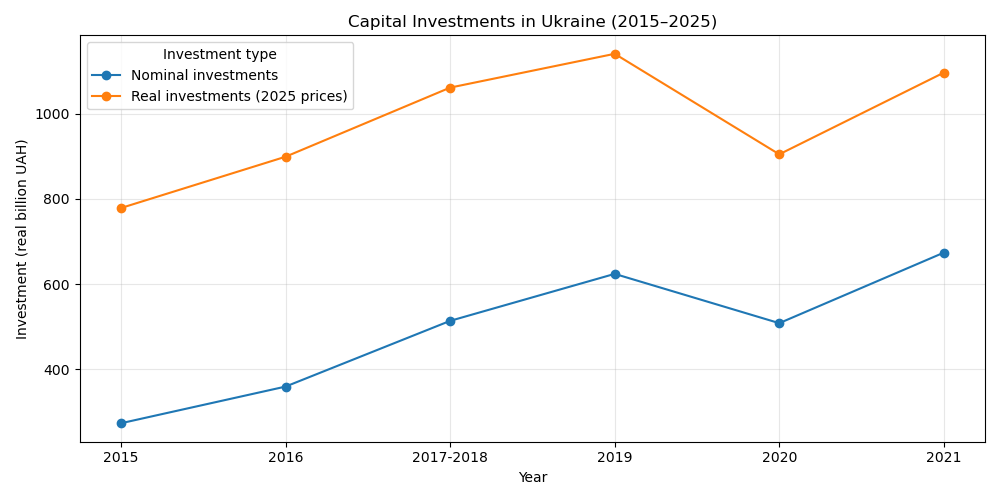
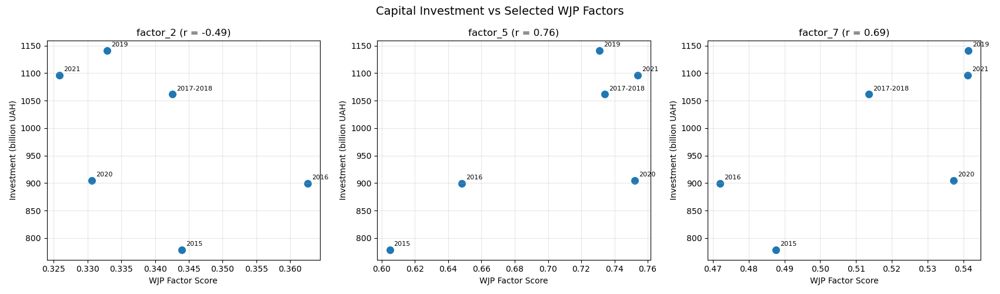

# Капітальні інвестиції в Україні: як змінилися їхня динаміка, регіональний розподіл та зв’язок із верховенством права

*Аналіз даних за 2015–2025 роки показує, як повномасштабна війна вплинула на інвестиційну активність України, чому номінальне зростання не завжди означає реальне відновлення та які інституційні показники демонструють найбільш помітний зв’язок з інвестиціями.*

## Вступ

Капітальні інвестиції є одним із важливих показників економічного розвитку країни. Вони відображають вкладення підприємств та інших суб’єктів господарювання у придбання, створення й модернізацію основних засобів. Від інвестиційної активності залежить оновлення виробничих потужностей, розвиток інфраструктури, розширення бізнесу та створення передумов для економічного зростання.

Для України це питання набуло особливого значення після початку повномасштабного вторгнення у 2022 році. Воєнні ризики, руйнування інфраструктури, переміщення підприємств та зміна економічної активності регіонів суттєво вплинули на умови інвестування.

Водночас оцінювати інвестиційну динаміку лише за номінальними показниками недостатньо. Зростання обсягів вкладень у гривнях може бути частково зумовлене інфляцією, а не фактичним збільшенням інвестиційної активності.

Мета цього дослідження — проаналізувати динаміку капітальних інвестицій в Україні у 2015–2025 роках, визначити зміни в їхньому регіональному розподілі та дослідити, чи спостерігається зв’язок між інвестиційною активністю та показниками верховенства права.

## Номінальне зростання не завжди означає реальне відновлення

У період 2015–2018 років капітальні інвестиції в Україні демонстрували загальну тенденцію до зростання. У 2018 році їхній обсяг досяг приблизно 578,7 млрд грн у номінальному вимірі. Наступного року темпи зростання суттєво сповільнилися, а у 2020 році відбулося помітне скорочення інвестиційної активності.

У 2021 році ситуація покращилася: номінальний обсяг капітальних інвестицій зріс на 32,6% порівняно з попереднім роком.

Однак номінальні показники не повністю відображають реальну картину. Для врахування зміни цін було проведено коригування обсягів інвестицій за допомогою середньорічного індексу споживчих цін (CPI), а всі значення приведено до цін 2025 року.

Результати показали, що у 2018 році реальний обсяг капітальних інвестицій становив приблизно 1 141,7 млрд грн. У 2019 році він практично не змінився, а у 2020 році скоротився на 20,7%. Попри зростання на 21,2% у 2021 році, інвестиції так і не повернулися до рівня 2018 року.

Найбільше падіння відбулося у 2022 році. Реальний обсяг капітальних інвестицій скоротився приблизно на 49,4% порівняно з 2021 роком. Це збіглося з початком повномасштабного вторгнення Росії та масштабними змінами в економічному середовищі країни.

У наступні роки спостерігалося поступове відновлення. У 2023 році реальні інвестиції зросли на 35,7%, у 2024 році — на 11,2%, а у 2025 році — ще на 6,7%.

Проте навіть після трьох років зростання відновлення залишалося неповним. У 2025 році реальний обсяг капітальних інвестицій становив приблизно 893,6 млрд грн — на 21,7% менше, ніж у 2018 році.

Таким чином, рекордні номінальні показники 2025 року не означають повернення до попереднього рівня інвестиційної активності з урахуванням зміни цін.

## Регіональний розподіл: концентрація інвестицій посилюється

Загальнонаціональні показники не дозволяють повністю оцінити ситуацію, оскільки інвестиційна активність суттєво відрізняється між регіонами.

Регіональний аналіз показав, що капітальні інвестиції в Україні розподілені нерівномірно. Значна їхня частина зосереджена у Києві та кількох найбільших регіонах.

У 2025 році на Київ припадало приблизно 37,3% загального обсягу капітальних інвестицій. Наступними за часткою були Дніпропетровська область (9,7%), Київська область (8,2%) та Львівська область (7,3%).

Сукупна частка десяти найбільших регіонів становила близько 79,4%. Це означає, що майже чотири п’ятих усіх капітальних інвестицій припадали лише на десять регіонів.

Порівняння 2021 та 2025 років також виявило посилення концентрації. Частка трьох найбільших регіонів зросла з 48,59% до 55,20%, а п’яти найбільших — з 58,08% до 65,74%.

Окремо було порівняно середні регіональні частки за два періоди: 2015–2021 роки та 2022–2025 роки.

Найбільше зростання середньої частки продемонстрував Київ — з 31,92% до 35,70%. Помітне збільшення також спостерігалося у Львівській області — на 1,84 відсоткового пункту.

Натомість найбільше скорочення середньої частки зафіксовано у Донецькій області — на 3,35 відсоткового пункту. Зменшення також спостерігалося у Херсонській, Запорізькій та Харківській областях.

Отримані результати свідчать про зміну географічної структури інвестицій: відносна роль Києва та окремих західних і центральних регіонів зросла.

Водночас ці зміни не можна пояснювати виключно війною. На результати впливають економічна структура регіонів, переміщення підприємств, безпекова ситуація та зміни у статистичному охопленні територій.

### Частка інвестицій і внесок регіонів в економіку

Щоб глибше оцінити регіональний розподіл капітальних інвестицій, було проведено додаткове порівняння їхньої частки з часткою кожного регіону у валовому регіональному продукті (ВРП). Для цього використано дані за 2021 рік — останній рік, за який у використаному наборі Держстату доступні зіставні регіональні показники ВРП.

Результати показали, що в окремих регіонах частка капітальних інвестицій помітно відрізняється від їхньої частки у створенні ВРП.

Найбільша позитивна різниця спостерігалася в Києві: на місто припадало 30,37% усіх капітальних інвестицій, тоді як його частка у ВРП становила 23,42%. Різниця дорівнювала майже 7 відсотковим пунктам.

Вища частка інвестицій порівняно з часткою ВРП також спостерігалася у Рівненській області (3,19% проти 1,63%), Київській області (6,57% проти 5,35%) та Дніпропетровській області (11,65% проти 10,68%).

Протилежна ситуація була у Харківській області: її частка в капітальних інвестиціях становила 3,66%, тоді як частка у ВРП — 5,87%. Від'ємна різниця також спостерігалася в Одеській та Запорізькій областях.

Це порівняння демонструє, що географічний розподіл капітальних інвестицій не повністю збігається з розподілом економічної активності між регіонами. Водночас різницю між частками не слід безпосередньо трактувати як показник ефективності інвестицій або недостатнього фінансування регіону. На неї можуть впливати галузева структура економіки, капіталомісткість виробництва та реалізація окремих великих інвестиційних проєктів.

Таким чином, зіставлення з ВРП доповнює аналіз регіональної концентрації та дає змогу побачити структурні відмінності між розподілом інвестицій і створенням економічної доданої вартості.

.png)

## Чи пов’язане верховенство права з інвестиційною активністю?

Окрім економічних показників, на інвестиційні рішення можуть впливати інституційні умови: передбачуваність законодавства, ефективність судової системи, захист прав власності та рівень корупції.

Для дослідження цього аспекту було використано World Justice Project (WJP) Rule of Law Index — міжнародний індекс, який оцінює стан верховенства права за кількома напрямами.

Порівняння реальних капітальних інвестицій із загальним показником WJP за 2015–2021 роки виявило позитивну кореляцію: коефіцієнт Пірсона становив 0,719, а коефіцієнт Спірмена — 0,714.

Це означає, що в межах досліджуваного періоду вищим значенням індексу верховенства права загалом відповідали вищі обсяги реальних інвестицій.

Проте зв’язок виявився слабшим, ніж у початковому аналізі номінальних інвестицій. Це вказує на те, що інфляційне зростання номінальних показників могло посилювати початкову кореляцію.

Важливо також, що динаміка двох показників не була повністю синхронною. Наприклад, у 2020 році реальні капітальні інвестиції скоротилися на 20,7%, тоді як оцінка верховенства права продовжила поступово зростати.

Додатковий аналіз окремих складових WJP показав різні результати. Найсильніший позитивний зв’язок із реальними інвестиціями спостерігався для фактора Order and Security (Порядок і безпека) — коефіцієнт Пірсона становив 0,76. Для Civil Justice (Цивільне правосуддя) він дорівнював 0,69.

Натомість Absence of Corruption (Відсутність корупції) продемонстрував негативну кореляцію на рівні -0,49. Однак після усунення лінійного часового тренду цей зв’язок став майже нульовим. Тому його не можна трактувати як свідчення того, що зростання корупції сприяє інвестиціям.

### Наскільки стійкими є виявлені зв'язки?

Для додаткової перевірки результатів було оцінено кореляції після усунення лінійного часового тренду, а також проведено перевірку чутливості до окремих спостережень методом leave-one-out.

Після усунення часового тренду зв'язок між реальними інвестиціями та окремими факторами WJP став слабшим. Для Absence of Corruption коефіцієнт кореляції змінив знак і становив приблизно 0,14, для Civil Justice — 0,28, тоді як для Order and Security залишився помітнішим — близько 0,53.

Перевірка leave-one-out показала, що знаки кореляцій для трьох досліджуваних факторів зберігалися незалежно від виключення одного спостереження. Однак величина коефіцієнтів змінювалася. Наприклад, кореляція Order and Security з реальними інвестиціями коливалася від 0,49 до 0,97 залежно від того, який рік виключався з вибірки.

Це свідчить про те, що напрямок виявлених зв'язків є відносно стабільним у межах наявних даних, але їхня сила чутлива до окремих років.

Важливо враховувати й обмежений обсяг вибірки: аналіз базується лише на шести спостереженнях. Крім того, обидва показники мають загальну висхідну тенденцію протягом досліджуваного періоду. Тому частина початкової кореляції може пояснюватися спільним часовим трендом, а не безпосереднім зв'язком між інституційним середовищем та інвестиційною активністю.

Отже, результати слід розглядати як попередні статистичні спостереження. Вони не дають достатніх підстав стверджувати про незалежний вплив окремих складових верховенства права на обсяги капітальних інвестицій.

Отже, результати вказують на наявність певного зв’язку між інституційним середовищем та інвестиційною активністю, але не дають підстав стверджувати, що зміни показників верховенства права безпосередньо спричиняють зміну обсягів інвестицій.

## Що показують результати для економічного відновлення України?

Проведений аналіз дозволяє виділити кілька важливих тенденцій.

По-перше, відновлення інвестиційної активності після 2022 року відбувається поступово, але залишається неповним. Навіть зростання реальних інвестицій протягом 2023–2025 років не забезпечило повернення до рівня 2018 року.

По-друге, інвестиції стають більш концентрованими географічно. Зростання частки Києва та кількох інших регіонів свідчить про нерівномірність інвестиційної активності. Це важливо враховувати під час планування регіонального розвитку та відновлення інфраструктури.

По-третє, інституційне середовище залишається важливим напрямом для подальшого дослідження. Виявлені кореляції показують, що окремі виміри верховенства права можуть бути пов’язані з інвестиційною активністю, однак для підтвердження таких залежностей потрібні довші часові ряди та додаткові економічні змінні.

Таким чином, економічне відновлення України не можна оцінювати лише за загальним зростанням інвестицій. Не менш важливими є їхня реальна купівельна спроможність, географічний розподіл та інституційні умови, у яких ухвалюються інвестиційні рішення.

## Висновки

Дослідження капітальних інвестицій в Україні за 2015–2025 роки показало, що інвестиційна активність зазнала значних змін: від зростання до 2018 року та різкого скорочення у 2022 році до поступового, але неповного відновлення у наступні роки.

По-друге, інвестиції стають більш концентрованими географічно. Зростання частки Києва та кількох інших регіонів свідчить про нерівномірність інвестиційної активності. Додаткове порівняння з ВРП за 2021 рік показало, що в окремих регіонах частка інвестицій перевищувала їхню частку у створенні регіонального продукту, тоді як в інших спостерігалася протилежна ситуація. Це підкреслює відмінності між географічним розподілом інвестицій та економічною структурою країни.

По-третє, інституційне середовище залишається важливим напрямом для подальшого дослідження. Найпомітніший позитивний зв'язок із реальними інвестиціями серед розглянутих факторів WJP продемонстрували Order and Security та Civil Justice. Однак перевірки стійкості показали, що сила цих зв'язків залежить від часового тренду та окремих спостережень. Тому для підтвердження таких залежностей потрібні довші часові ряди та додаткові економічні змінні.

Загалом результати свідчать, що майбутнє економічне відновлення України залежатиме не лише від збільшення обсягів капітальних вкладень, а й від того, наскільки рівномірно вони розподілятимуться між регіонами та наскільки передбачуваними будуть умови для інвесторів.

## Джерела даних

1. Державна служба статистики України — дані щодо капітальних інвестицій за регіонами та роками.
2. Державна служба статистики України — індекси споживчих цін (CPI).
3. World Justice Project — Rule of Law Index, історичні дані за 2015–2021 роки.
4. Державна служба статистики України — регіональні рахунки, валовий регіональний продукт за регіонами (2004–2021 роки).

**Примітка щодо методології:** Для оцінювання реальної динаміки інвестицій номінальні значення скориговано за середньорічним індексом споживчих цін та приведено до цін 2025 року. CPI не є спеціалізованим дефлятором капітальних інвестицій, тому реальні значення є наближеною оцінкою. Регіональні порівняння також обмежені змінами статистичного охоплення тимчасово окупованих і постраждалих від бойових дій територій. Аналіз зв’язку з WJP базується лише на шести спостереженнях, оскільки період 2017–2018 років представлено одним об’єднаним випуском індексу.